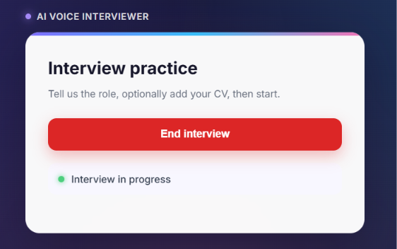
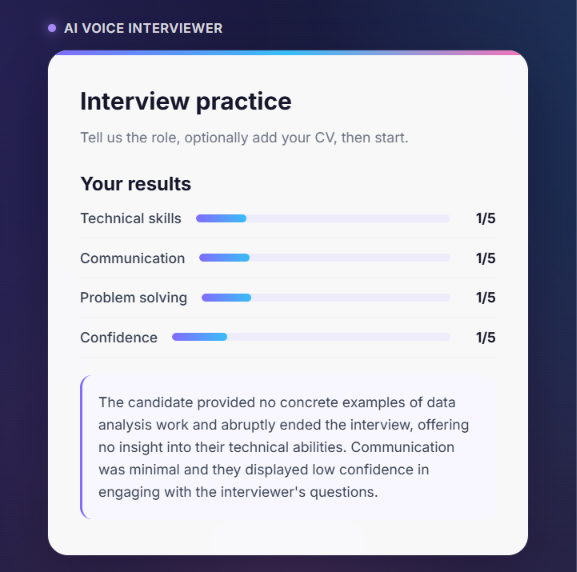

# AI Voice Interviewer

A real-time voice interview agent. You enter the job role and optionally upload your CV, then have a spoken interview with an AI interviewer. It asks role-specific questions, follows up on vague answers, references projects from your CV, and decides for itself when the interview is complete. Afterwards, it scores you from 1–5 on four skills and writes a short summary.

Built during my AI Engineering internship at e& (Etisalat), June–August 2026.

| During the interview | Results |
|---|---|
|  |  |

## Features

- **Real-time voice conversation:** low-latency speech in both directions over WebRTC
- **Role-aware questions:** tailored to the job title you enter, or the agent asks what role you want
- **CV personalisation:** an uploaded PDF CV is parsed and used to ask about your actual projects and experience
- **Natural interview flow:** asks follow-ups, chooses when enough has been covered (usually 5–8 exchanges), then ends the call politely by itself
- **Automatic scorecard:** after the call, the full transcript is evaluated on Technical Skills, Communication, Problem Solving and Confidence, with a written summary
- **Optional access code:** restricts who can start an interview

## Architecture

```
Browser (index.html)
   │  1. Upload CV / set role ─────────────► FastAPI backend (main.py)
   │  2. Request access token ◄────────────      │
   │                                              │ saves CV + role to disk
   │  3. Join room (WebRTC audio)                 │
   ▼                                              ▼
LiveKit room ◄──────────────────────► Voice agent (agent.py)
                                         │
                                         ├─ Silero VAD    – detects when you start/stop speaking
                                         ├─ Deepgram Nova-3 – speech-to-text
                                         ├─ GPT-OSS 120B via Groq – interviewer reasoning
                                         └─ Cartesia      – text-to-speech
                                         │
                                         ▼ on call end
                                    Transcript → LLM evaluation → scorecard.json
   ▲                                              │
   └── 4. Poll /scorecard ◄───────────────────────┘
```

## Tech Stack

| Component | Technology |
|---|---|
| Real-time audio | LiveKit Agents (WebRTC) |
| Speech-to-text | Deepgram Nova-3 |
| LLM | GPT-OSS 120B via Groq (originally Llama 3.3 70B, migrated after Groq retired it) |
| Text-to-speech | Cartesia |
| Voice activity detection | Silero VAD |
| Backend | FastAPI |
| CV parsing | pypdf |
| Frontend | HTML/JS with the LiveKit client SDK |

## API (backend)

| Method | Endpoint | Purpose |
|---|---|---|
| GET | `/` | Serves the web interface |
| POST | `/upload-cv` | Uploads the candidate's CV (PDF) |
| POST | `/set-role` | Saves the target job title |
| GET | `/get-token?code=` | Returns a LiveKit access token to join the interview room |
| GET | `/scorecard` | Returns the scorecard (`202` while it's still being generated) |

## Running Locally

1. Clone the repo and install dependencies (Python 3.11):
   ```
   git clone https://github.com/uzair852/voice-interviewer.git
   cd voice-interviewer
   pip install -r requirements.txt
   python agent.py download-files
   ```
2. Create a `.env` file:
   ```
   LIVEKIT_URL=wss://your-project.livekit.cloud
   LIVEKIT_API_KEY=your_livekit_key
   LIVEKIT_API_SECRET=your_livekit_secret
   DEEPGRAM_API_KEY=your_deepgram_key
   CARTESIA_API_KEY=your_cartesia_key
   GROQ_API_KEY=your_groq_key
   ACCESS_CODE=optional_code
   ```
   A free LiveKit Cloud project is enough.
3. Start the backend and the agent in two terminals:
   ```
   uvicorn main:app --reload
   ```
   ```
   python agent.py dev
   ```
4. Open http://localhost:8000, enter a role, optionally upload a CV, and start the interview.

## Known Limitations

- **One interview at a time:** all candidates join the same room, and the CV, role and scorecard are stored as single files.
- **Shared disk required:** the backend and agent exchange the CV, role and scorecard through local files, so they need to run on the same machine. Deploying them as separate containers (`Dockerfile.backend` and `Dockerfile.agent`) would need shared storage or a database instead.

Next steps would be per-session rooms and storing session data in a database, so multiple candidates can be interviewed at the same time.

## Documentation

See [Task3_Solution_Document.pdf](Task3_Solution_Document.pdf) for the full design write-up.
